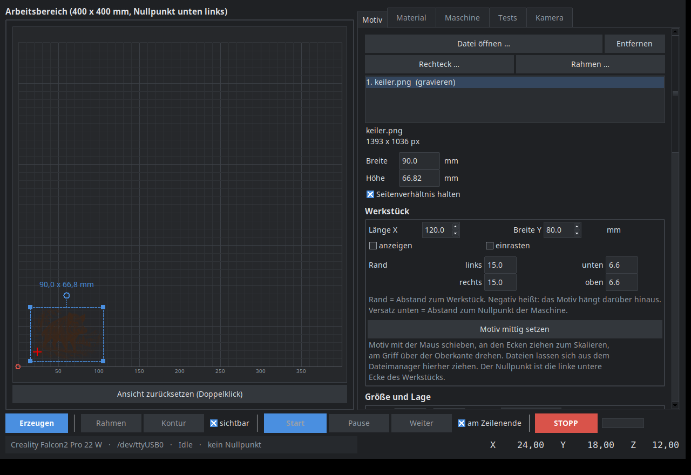
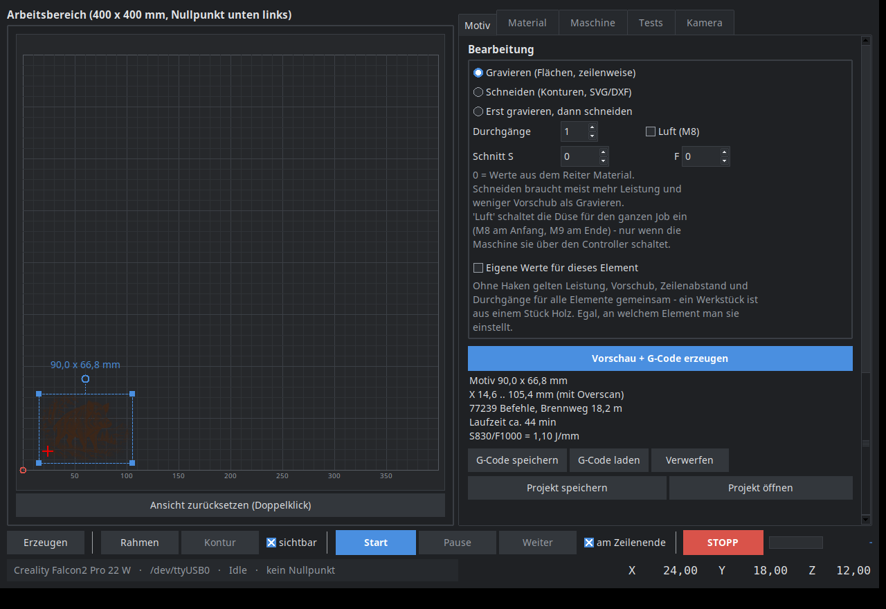
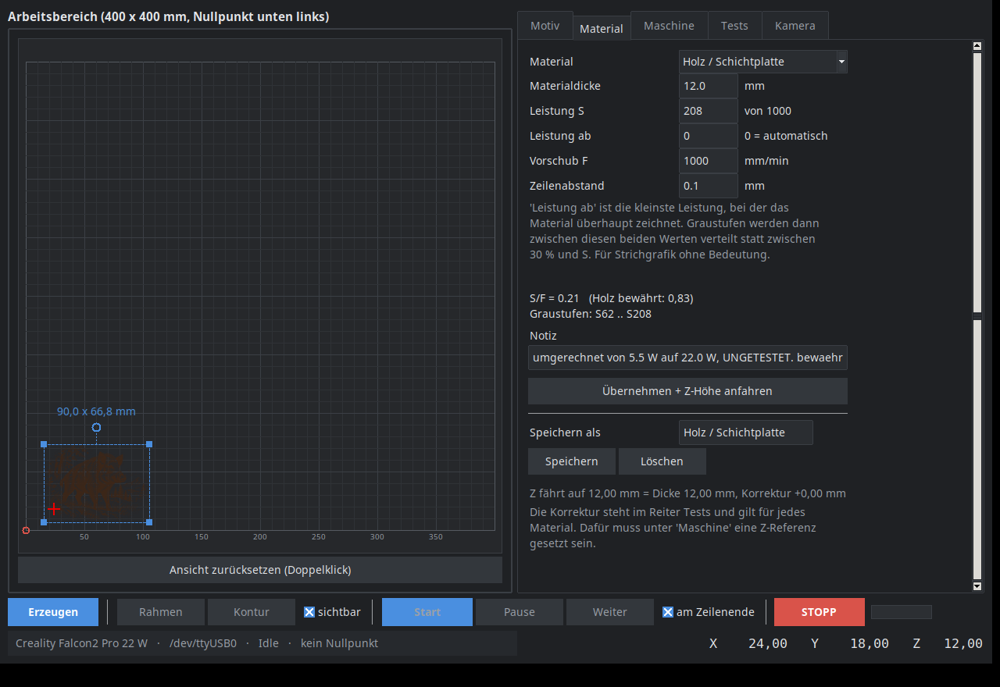
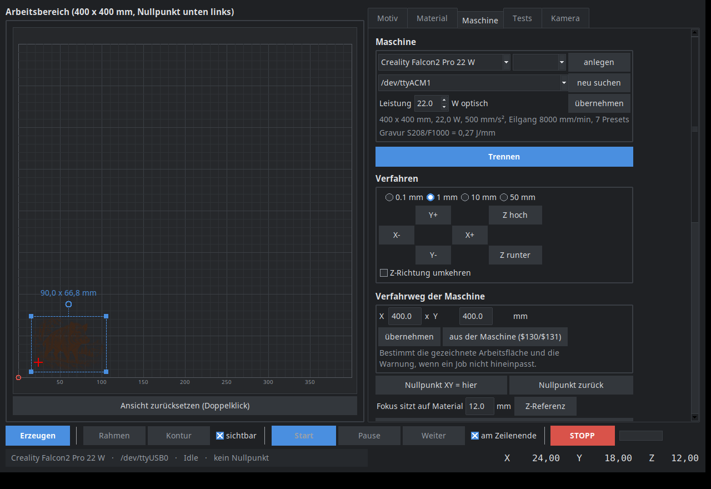
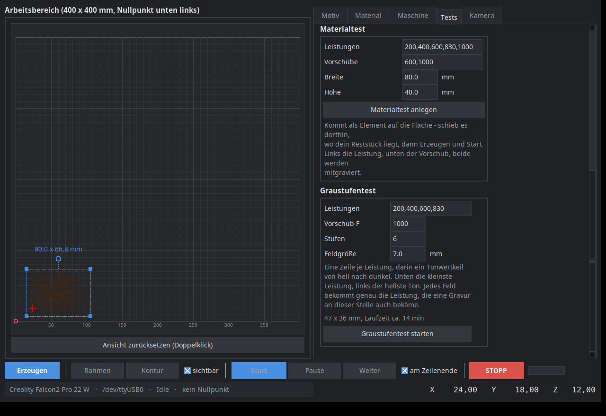

# Laserwerk

*[English](README.md) · **Deutsch***

Ein Steuerprogramm für Diodenlaser an GRBL-Controllern, für Linux, auf Deutsch.
Bild oder SVG hineinwerfen, auf dem simulierten Werkstück platzieren, Achsen
fahren, Fokus suchen, gravieren oder schneiden — in einem Fenster, ohne
Abonnement und ohne Cloud.



Entstanden, weil es auf Linux wenig dazwischen gibt: LightBurn kostet Geld,
LaserGRBL läuft nur unter Windows, und der Weg über Inkscape-Erweiterungen und
einen reinen G-Code-Sender ist umständlich, sobald man Graustufen rastern oder
Material ausprobieren will.

> **Die Oberfläche gibt es auf Deutsch und Englisch** (Reiter *Maschine* →
> *Sprache*). Kommentare und Bezeichner im Quelltext sind deutsch.

## Kann

- **Anlauf aus der Maschine** — im Lasermodus skaliert GRBL mit `M4` die
  Leistung mit der Geschwindigkeit. Ist der Anlauf kürzer als der
  Beschleunigungsweg, brennt der Zeilenanfang zu schwach. Laserwerk rechnet
  ihn aus Vorschub und `$120` aus: bei F1000 und 30 mm/s² sind das 4,6 mm,
  nicht die 1,5 mm, die man üblicherweise einstellt. Genau das tut das Feld
  von Haus aus — es steht auf `0`, also „rechne ihn aus". Eine Zahl trägt man
  nur ein, wenn man es anders will.
- **Gravieren** — Bilder (PNG, JPG, WEBP, BMP) und SVG als Raster, zeilenweise:
  schwarzweiß mit Schwelle, Graustufen mit veränderlicher Leistung oder
  Rasterung nach Floyd-Steinberg, bei der alle Punkte gleich stark brennen und
  der Tonwert aus der Punktdichte kommt — das Mittel für Material mit scharfer
  Schwelle. Dazu ein Tonwertregler für die Mitten und Anlauf (Overscan) an den
  Zeilenenden.
- **Energie je Millimeter** — was schneidet, ist nicht die Leistung, sondern
  `0,33 · S/F · Durchgänge` J/mm. Laserwerk schreibt sie neben jeden Schnitt.
  Und weil Leistung, Vorschub und Durchgänge zum Element gehören: liegen sie
  in einem Job weit auseinander, fragt Laserwerk vor dem Erzeugen nach und
  bietet an, die stärksten für alle zu übernehmen. Vorher wurde ein Teil
  durchgeschnitten und die anderen vier mit den Gravurwerten nur angeritzt —
  0,27 gegen 6,0 J/mm, zu sehen erst am Werkstück.
- **Schneiden** — Konturen aus SVG und DXF, innen vor außen, mehrere Durchgänge,
  Originalgröße 1:1 für Schablonen aus dem CAD.
- **Beides in einem Lauf** — erst gravieren, dann ausschneiden, mit eigener
  Leistung und eigenem Vorschub für den Schnitt. In dieser Reihenfolge, sonst
  fällt das Teil heraus, bevor es graviert ist.
- **Bildkorrektur** — Helligkeit, Kontrast und Schärfen, dazu ein
  Auto-Knopf, der Schwarz- und Weißpunkt aus dem Bild holt. Fotos brauchen
  das fast immer: ein hellgrauer Hintergrund brennt sonst als dünner
  Punkteteppich mit und frisst den Kontrast des Motivs.
- **Farben als Ebenen** — eine SVG mit mehreren Strichfarben lässt sich
  beim Laden in Ebenen aufteilen: Rot wird geschnitten, der Rest graviert.
  Alle Ebenen behalten Maßstab und Lage der ganzen Zeichnung, liegen also
  in Deckung. Graviert wird die Strichzeichnung der Ebene, nicht das
  gefüllte Original.
- **Schnittvorlage ohne Schnittlinien** — eine SVG, die das Motiv als
  eingebettetes Bild und die Schnittlinien als Pfade drumherum trägt, wird
  gerastert, als stünde nur das Bild darin. Sonst brennt sich das
  Puzzlemuster quer durchs Motiv, und die Vorlage taugt für den nächsten
  Durchgang nichts mehr. Der Schalter steht bei den Gravureinstellungen und
  taucht nur auf, wenn die Datei wirklich beides enthält. Breite und Höhe
  gelten dabei für die **Gravur**; der Schnitt behält seinen Abstand zu ihr
  und steht deshalb über das Motivrechteck hinaus. Er braucht ringsum Platz
  — liegt er vor dem Nullpunkt, sagt Laserwerk, welcher Versatz reicht.
- **Mehrere Elemente** — Motiv als PNG, Rahmen als SVG, beides auf demselben
  Werkstück: jedes Element mit eigener Datei, eigener Platzierung und eigenen
  Werten, gemeinsam in einer Vorschau, einem G-Code und einer Projektdatei.
  Erst wird alles graviert, dann alles geschnitten — auch bei Elementen, die
  selbst beides tun. Sonst läge das erste Teil schon lose im Brett, während
  das zweite noch graviert wird. Die Betriebsart gehört zum Element: wer sie
  umschaltet, wird gefragt, ob die anderen mitkommen — fünf Schnittdateien
  laden und einmal „Schneiden“ klicken hieß sonst, vier davon zu gravieren.
  Ein neu geladenes Motiv legt sich neben die vorhandenen, nicht darauf, und
  fängt eine neue Reihe an, wenn die alte voll ist. Eine Zeichnung kommt
  dabei im Originalmaß herein — ein Schnitt, der auf den Verfahrweg
  aufgeblasen wird, ist nie gemeint.
- **Formen zeichnen** — ein Rechteck mit Maßen und Eckradius, oder gleich ein
  Rahmen um das gewählte Motiv mit einem Abstand ringsum. Braucht keine
  Zeichensoftware für den einfachen Fall und steht danach als ganz normales
  Element da. In der Projektdatei stehen nur die paar Zahlen, kein Bild.
- **Platzieren** — Werkstück mit Länge und Breite angeben, Motiv mit der Maus
  darauf schieben und an den Ecken skalieren, mit Einrasten auf Kanten, Ecken
  und Mitte. Drehen in beliebigen Winkeln, nicht nur in 90er-Schritten.
  Die Abstände zu den vier Kanten stehen als Felder daneben — ablesbar beim
  Schieben und eintippbar, wenn es genau 5 mm vom rechten Rand sein soll.
- **Kontur abfahren** — nicht nur den umschließenden Kasten, sondern die
  echte Schnittkontur aus SVG oder DXF, mit schwachem Strahl. Bei einem
  gedrehten oder runden Teil sagt das Rechteck wenig darüber, ob es aufs
  Brettchen passt.
- **Maschine fahren** — Achsen tippen, Nullpunkt setzen, Z-Referenz,
  Rahmenfahrt um das Motiv, Sichtkreuz mit schwacher Leistung („wo steht er
  gerade?"), Entsperren, einzelne G-Code-Befehle.
- **Zwei Maschinen** — wer abwechselnd an zwei Lasern arbeitet, wählt sie
  oben im Reiter „Maschine" aus. Verfahrweg, Beschleunigung, Eilgang,
  Leistung, Fokuskorrektur, die Laufzeitmessungen **und die Presets**
  wechseln mit: S/F ist an einer Leistung gemessen, und dieselbe Liste an
  5,5 W und an 22 W wäre eine Falle, die beim ersten Brett zuschlägt. Eine
  neue Maschine fängt mit den Werten der jetzigen an oder mit einer
  bekannten Vorlage, und auf Wunsch rechnet Laserwerk die Presets auf die
  neue Leistung um — jeder umgerechnete Wert bekommt den Vermerk
  „UNGETESTET". Meldet die angeschlossene Maschine beim Verbinden einen
  Verfahrweg, der zu einer anderen gespeicherten passt, fragt Laserwerk
  nach: umgesteckt und vergessen umzuschalten ist sonst genau das erste
  verbrannte Brett.
- **Die Maschine sagt ihre Werte selbst** — beim Verbinden liest Laserwerk
  `$$` und übernimmt Beschleunigung (`$120`/`$121`), Eilgang (`$110`/`$111`)
  und Kreuzungstoleranz (`$11`) in das Zeitmodell, warnt bei `$30` ≠ 1000,
  bei abgeschaltetem Lasermodus (`$32`) und bei einem Verfahrweg, der nicht
  zu `$130`/`$131` passt. Bei zwei verschiedenen Achswerten gilt der
  kleinere — der bremst. Nur die optische Leistung in Watt trägt man ein:
  die kennt die Maschine nicht, und ohne sie ist die Energie je Millimeter
  eine Zahl ohne Bezug. 30 mm/s² und 3000 mm/min sind nicht dasselbe wie
  500 und 8000.
- **Material finden** — Fokustest über Z, Materialtest als Feldraster aus
  Leistungen und Vorschüben, Graustufentest mit einem Tonwertkeil je
  Leistung, Presets mit Materialdicke, Leistung, Vorschub,
  Zeilenabstand, Tonwert **und den Schnittwerten** — Durchgänge, Schnitt-S
  und Schnitt-F sind die Zahlen, die am meisten Zeit zum Herausfinden kosten.
- **Fokuskorrektur gehört der Maschine** — sie sagt, wo die Brennebene
  wirklich zur Z-Referenz liegt, und das hängt an Linse und Aufbau, nicht am
  Material. Sie steht deshalb einmal zentral, nicht in jedem Preset, und
  übersteht den Neustart: der Fokustest hat sie gemessen, und wer sie von Hand
  in ein Preset tippen soll, verliert sie. Zu sehen beim Start im Protokoll,
  als Z-Höhe unter Material und beim Fokustest — dort auch als Feld, das sich
  ohne neuen Test nachstellen lässt.
- **Laufzeit, die dazulernt** — die Schätzung rechnet je Bahn ein Trapez
  aus Vorschub und Beschleunigung; für einen Leistungswechsel hält die Achse
  nicht an, also bremst eine feinere Zerlegung sie auch nicht. Richtungs-
  wechsel bremsen dagegen sehr wohl: an jeder Ecke lässt `$11` nur ein
  bestimmtes Tempo durch, und eine nachgezeichnete Kontur hat Hunderte davon.
  Laserwerk rechnet sie wie GRBLs Planer mit — ohne das war ein Schnitt um
  fast die Hälfte zu kurz angesagt. Nach jedem fertigen Job steht im
  Protokoll, was angesagt war und was es gedauert hat, und ab dem dritten
  Lauf korrigiert der Median der Messungen das Modell. Gemessen statt
  geglaubt — ein einzelner Lauf ändert nichts.
- **Zweiseitig gravieren** — Spiegeln an einer Wendeachse, mit Prüfung, ob das
  gespiegelte Motiv noch im positiven Bereich liegt.
- **Fernsteuerung über Telegram** — Achsen und Sichtkreuz vom Handy, während man
  am Werkstück steht, einen laufenden Job anhalten und fortsetzen, den
  Nullpunkt zurückholen. Meldet sich, wenn ein Job fertig ist oder in Alarm
  geht. Die Befehle stehen im Menübutton von Telegram, und das Steuerkreuz
  wird während eines Jobs zu Pause / Weiter / STOPP — Fahrbefehle sind dann
  ohnehin gesperrt.
- **Pause am Zeilenende** — ein Feed Hold hält sofort an, mitten in der Zeile.
  Der Strahl geht dabei zwar aus, aber die Bremsspur liegt im Motiv, und beim
  Weiterfahren fängt die Zeile aus dem Stand an. Mit dem Schalter in der
  Jobleiste wartet die Pause bis zur nächsten Zeile: der Kopf bleibt im
  Anlauf neben dem Motiv stehen, der Laser geht mit `M5` aus, und „Weiter"
  stellt den Modus wieder her, in dem der Job lief.
- **Übertragungsfehler im Protokoll** — am Jobende, nicht nur währenddessen in
  der Fortschrittsanzeige. Fehlt hinterher eine Zeile im Werkstück, ist die
  Fehlerzahl die einzige Spur, die das noch erklären könnte.
- **Trockenlauf** — `trockenlauf.py` liest einen fertigen G-Code so, wie GRBL
  1.1 ihn lesen würde, und sagt, wohin der Kopf fährt, wo der Strahl brennt,
  wie lange es dauert und was schiefginge: Befehle, die GRBL mit `error:20`
  überspringt, ein `G1` ohne je gesetzten Vorschub, ein stehender brennender
  Strahl, Koordinaten hinter dem Verfahrweg, `S` über `$30`. Auf Wunsch
  zeichnet er das Ergebnis als Bild und sagt, an welcher Stelle ein
  bestimmter Befehl steht. An die Maschine geht dabei nichts.
- **Fortsetzen** — `fortsetzen.py` findet nach einem hängengebliebenen Job die
  genaue Stoppstelle über die Position und streamt den Rest.
- **Nullpunkt gilt die ganze Sitzung** — der Abbruch setzt den Controller
  zurück und löscht dabei dessen G92-Versatz. Laserwerk führt den Versatz mit
  und setzt ihn danach neu, damit „Zum Nullpunkt fahren" weiter das Werkstück
  meint und nicht den Nullpunkt der Maschine. Das gilt egal, woher der STOPP
  kam — Knopf oder Handy — und egal, wie lange man sich danach mit dem
  Entsperren Zeit lässt. Ist er doch einmal weg, holt ihn `/nullzurueck`
  zurück. Auch ein Nullpunkt, der auf der Maschinennull liegt — wer ihn
  gleich nach dem Verbinden setzt, hat genau den — zählt dabei als gemerkt.
  Nur ein USB-Abriss beendet das: danach weiß niemand mehr, wo der
  Kopf steht, und ein wiederhergestellter Versatz wäre schlimmer als keiner.
- **Eine Zeile sagt, woran man ist** — Maschine, Anschluss, Zustand,
  Nullpunkt, Z-Referenz unten links, die Position unten rechts; während
  eines Jobs dort die laufende Zeile. Die Jobleiste ist in Gruppen geteilt
  (vorbereiten — zielen — fahren — STOPP), und was gerade nicht geht, ist
  abgeblendet statt mit einer Meldung zu antworten. Rechts außen steht in
  Akzentfarbe, was als Nächstes dran ist — „Motiv öffnen", „G-Code
  erzeugen", „Maschine verbinden", „Nullpunkt setzen", „bereit". Die
  Erklärtexte lassen sich in einem Zug ausblenden, sobald man sie nicht
  mehr braucht.

## So sieht das aus

Erzeugter G-Code mit Laufzeitschätzung — das Motiv liegt als Brandspur auf dem
simulierten Brettchen, der Rahmen mit den Anfassern lässt sich mit der Maus
schieben und skalieren:



Materialwerte als Preset, Achsensteuerung und die Tests:

| | |
|---|---|
|  |  |



Während eines Laufs steht in der Statuszeile, bei welcher Zeile von wie
vielen der Kopf gerade ist — wie der Schichtzähler am 3D-Drucker. Beim
Schneiden zählt es Konturen statt Zeilen.

## Braucht

- Python 3.10 oder neuer, mit tkinter (`apt install python3-tk`)
- `pip install -r requirements.txt` — pyserial, Pillow, numpy
- optional `zenity` für native GTK-Dialoge; fehlt es, nimmt das Programm die
  Tk-eigenen
- einen GRBL-1.1-Controller am USB-Port, Benutzer in der Gruppe `dialout`

```sh
git clone https://github.com/eutervogel/laserwerk
cd laserwerk
pip install -r requirements.txt
./laserwerk.sh
```

Einstellungen, Presets und der Telegram-Token liegen unter
`~/.config/laserwerk/`, nicht im Projektordner.

## Sicherheit

Ein Diodenlaser verbrennt Material, Haut und Netzhaut, und er entzündet Späne,
Papier und Staub. Dieses Programm nimmt einem davon nichts ab.

- **Nie unbeaufsichtigt laufen lassen.** Eine Gravur läuft eine Stunde; ein
  Glimmnest braucht keine Minute.
- **Schutzbrille für die Wellenlänge des Lasers**, auch für alle, die zusehen.
  Blaues Streulicht an der Brennstelle reicht.
- **Absaugen oder ins Freie lüften.** Holzrauch ist unangenehm, manches andere
  giftig.
- **Kein PVC, kein Kunstleder, kein TPU** — dabei entsteht Chlorwasserstoff
  beziehungsweise Blausäure. Sie fressen auch die Mechanik.
- **Löschmittel in Reichweite.**
- Die Fernsteuerung fährt nur Achsen und das Sichtkreuz. Einen Job startet sie
  mit Absicht nicht: Volle Leistung gehört dorthin, wo jemand hinsieht. Auch
  Achsen bitte nur fahren, während man die Maschine im Blick hat.

## Die Materialwerte sind nicht deine

Die mitgelieferten Presets wurden auf **einer** Maschine gemessen: 450 nm,
5,5 W optisch. Anderer Laser, andere Linse, anderer Fokus, andere Werte. Sie
sind ein Startpunkt für einen eigenen Materialtest, kein Rezept. Zu viel
Leistung bei zu wenig Vorschub heißt nicht „dunkler", sondern irgendwann
„brennt".

Hat dein Material eine **scharfe Schwelle** — Buche etwa zeichnet erst ab
einer Leistung und verkohlt kurz darüber —, dann trag im Reiter *Material*
unter **Leistung ab** ein, wo es anfängt zu zeichnen. Die Tonwerte werden
dann zwischen diesem Wert und S verteilt statt zwischen 30 % und S. Ohne das
liegt die halbe Tonskala unter der Schwelle und macht gar nichts, während
die andere Hälfte einheitlich schwarz ist. Beide Werte liest du aus dem
Graustufentest ab. 0 heißt: wie bisher, 30 % von S.

Für **Graustufen** gilt das doppelt: Dort brennt jede Zeile über die ganze
Fläche, und die Nachbarzeile trifft schon vorgewärmtes Material. Gemessen
wurden auf der Referenzmaschine S175 auf Pappe und S130 auf Schichtplatte —
ein Sechstel dessen, was dasselbe Holz als Strichgrafik verträgt. Der S-Wert
ist dabei das Maximum, erreicht bei reinem Schwarz; darunter liegt ein Boden
bei 30 %, und fast weiße Stellen bleiben ganz aus. Läuft ein Motiv trotzdem
zu, hilft der Regler **Mitten** mehr als weniger Leistung: Er senkt nur die
Mitteltöne, Schwarz bleibt schwarz.

Was übertragbar ist, ist das **Verhältnis S/F**: Leistung geteilt durch
Vorschub, also die Energie je Millimeter. Auf der Referenzmaschine hat sich
Holz bei S830/F1000 = 0,83 bewährt, Wildleder bei 0,25, das Sichtkreuz läuft bei
0,08. Über etwa 0,20 brennt der Strahl sichtbar ein — deshalb weigert sich das
Programm, ein Sichtkreuz oberhalb davon zu fahren.

Beim **Schneiden** rechnet man besser gleich in Joule je Millimeter:
Leistung in Watt geteilt durch Vorschub in mm/s, mal Durchgänge. 3 mm Erle
trennt auf der Referenzmaschine ab etwa 3,3 J/mm und sauber bei 4,0
(5 × S725/F300 bei 5,5 W). Zwei Dinge folgen daraus. Erstens dauert ein
Schnitt **Energie geteilt durch Leistung** — wie viele Durchgänge man daraus
macht, ändert die Zeit nicht, nur die nötige Energie tut das. Zweitens liegt
der Brennpunkt bei dünnem Material **auf der Oberfläche**; ihn ins Material zu
legen klingt plausibel, kostete hier aber mehr als es brachte.

Alle Leistungen in der Oberfläche beziehen sich auf die Skala **0…1000**. Beim
Verbinden liest Laserwerk `$30` aus dem Controller und rechnet beim Senden um;
steht dort 255, wird aus S830 eben S212 — derselbe Anteil. Es warnt außerdem,
wenn `$32 = 0` ist, also der Lasermodus aus: dann brennt der Strahl auch im
Stillstand weiter, und jede Pause frisst ein Loch.

## Getestet mit

GRBL 1.1f auf einem CH340-Board, Diodenlaser mit 450 nm und 5,5 W optischer
Leistung, 200 × 200 mm Verfahrweg, Z-Achse mit Motor. Dort gelaufen:
Schichtplatte, Schiefer, Wildleder, Papier (geschnitten). Weißes PLA ist mit
einem blauen Laser nicht zu markieren — das Licht wird reflektiert.

Der Verfahrweg steht im Reiter *Maschine* und lässt sich aus `$130`/`$131`
übernehmen.

## Aufbau

| Datei | wofür |
|---|---|
| `laserwerk.py` | Oberfläche, Ablauf, Jobsteuerung |
| `lw_grbl.py` | serielle Anbindung, Streaming, Statusberichte |
| `lw_job.py` | Raster-G-Code, Laufzeitschätzung, Vorschaubilder, Tests |
| `lw_vector.py` | SVG- und DXF-Einleser, Konturen, Schnitt-G-Code |
| `lw_presets.py` | Materialwerte und Einstellungen |
| `lw_style.py` | helles und dunkles Farbschema |
| `lw_text.py` | deutsche und englische Texte der Oberfläche |
| `lw_dialog.py` | native Dialoge über zenity, mit Tk als Rückfall |
| `lw_telegram.py` | Fernsteuerung |
| `fortsetzen.py` | abgebrochenen Job an der Stoppstelle fortsetzen |
| `trockenlauf.py` | G-Code durchrechnen, ohne dass sich etwas bewegt |
| `waechter.py` | meldet per Telegram, bevor die Zeilen durch sind |
| `bilder/mach_bilder.py` | erzeugt die Bildschirmfotos, auf unsichtbarem Schirm |

Keine Fremdbibliotheken außer pyserial, Pillow und numpy. SVG, DXF und die
Telegram-Anbindung sind selbst geschrieben, damit nichts nachinstalliert werden
muss und nichts im Hintergrund Dialoge öffnet.

## Wächter für lange Jobs

Eine Fotogravur läuft gern zehn Stunden. Wer daneben sitzt, will nicht
stundenlang auf das Geblinke schauen, aber mitbekommen, wann die Zeilen durch
sind und das Schneiden anfängt — dafür gibt es `waechter.py`:

```sh
python3 waechter.py --vorlauf 10
```

Er läuft als **eigener Prozess neben** der Oberfläche, mitten im Job
gestartet, ohne Neustart. Er meldet per Telegram, wenn die Zeilen in etwa
`--vorlauf` Minuten durch sind (spätestens `--rest` Zeilen vorher), wenn das
Schneiden anfängt, wenn der Job vorbei ist, und wenn er die Oberfläche nicht
mehr sieht.

Wie er an den Stand kommt: über `tk send` liest er die Texte der
Anzeigefelder aus dem laufenden Tk-Interpreter — lesend, wie ein Blick auf
den Bildschirm. Er schreibt nichts in das laufende Programm, nichts an den
Controller, und die serielle Schnittstelle fasst er nicht an. Bei Telegram
ruft er nur `sendMessage`, niemals `getUpdates` — das darf allein der Bot in
der laufenden Oberfläche, zwei Abholer nehmen sich die Nachrichten weg
(HTTP 409).

`--lesen` sieht einmal hin und sendet nichts; gut zum Prüfen, ob er das
richtige Fenster vor sich hat.

## Trockenlauf vor der langen Nacht

Eine Gravur läuft zwölf Stunden. Hinterher zu merken, dass der Kopf auf X 310
sollte oder dass jede Zeile zu brennen anfing, bevor die Achse auf Tempo war,
ist ein teurer Weg, das herauszufinden:

```sh
python3 trockenlauf.py job.nc --bild vorschau.png
```

Er deutet die Datei wie der Controller — modaler Zustand, G90/G91, G20/G21,
M3 gegen M4, `S` und `F` durchgeschleppt — und nennt die Spanne in X und Y
gegen deinen Verfahrweg, den brennenden und den unbrennenden Weg, die Laufzeit
nach demselben geeichten Modell wie die Vorschau, das größte `S/F` und wo der
Kopf am Ende steht. Befunde werden gesammelt, nicht geworfen: ein Lauf zeigt
alles auf einmal.

`--bild` zeichnet, was auf dem Brett stehen würde. `--bei 1864777` sagt, in
welcher Zeile ein bestimmter Befehl steht und wo der Kopf dabei war — brauchbar,
wenn ein Job hängengeblieben ist und man wissen will, wo. Der Rückgabewert ist
1, sobald etwas gefunden wurde.

## Übersetzungen

`lw_text.py` ordnet jedem deutschen Text seine englische Entsprechung zu.
Fehlt ein Eintrag, erscheint einfach das Deutsche — nichts bricht. Für eine
weitere Sprache die Tabelle kopieren und `SPRACHEN` ergänzen.

## Tests

```sh
python3 -m unittest discover -s tests -t tests
```

441 Tests mit Bordmitteln, ohne Installation. Die Oberflächentests brauchen
eine Anzeige und werden ohne eine solche übersprungen; `xvfb-run -a` davor
lässt sie auf einem unsichtbaren Bildschirm laufen. Einzelheiten in
[tests/README.md](tests/README.md).

## Lizenz

MIT, siehe [LICENSE](LICENSE). Ohne jede Gewährleistung — besonders für das,
was deine Maschine damit anstellt.
