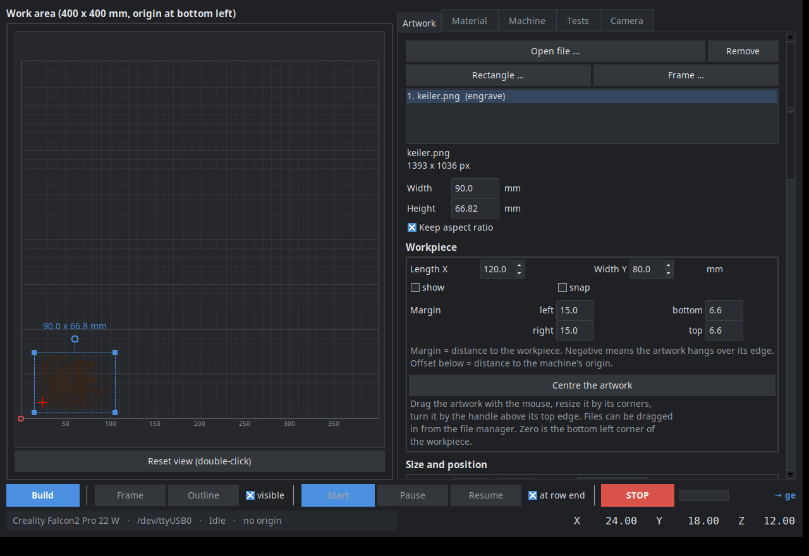
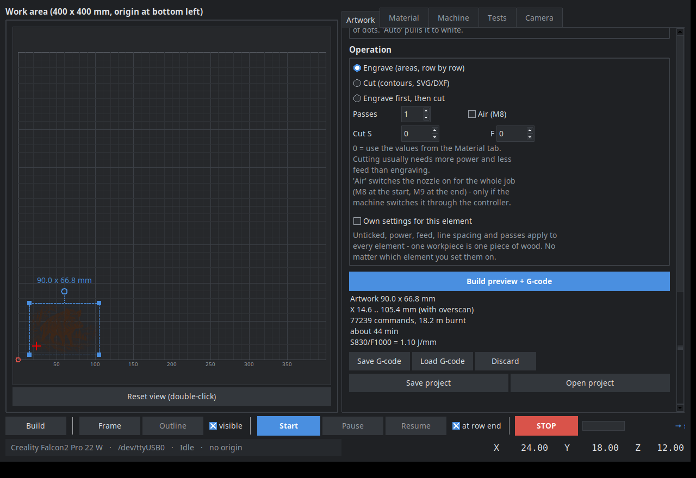
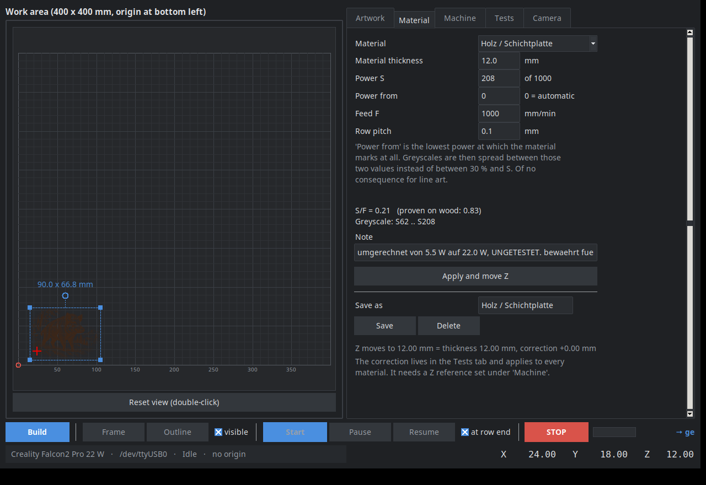
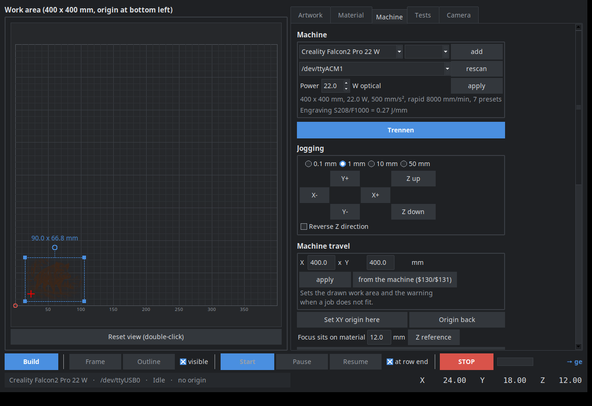
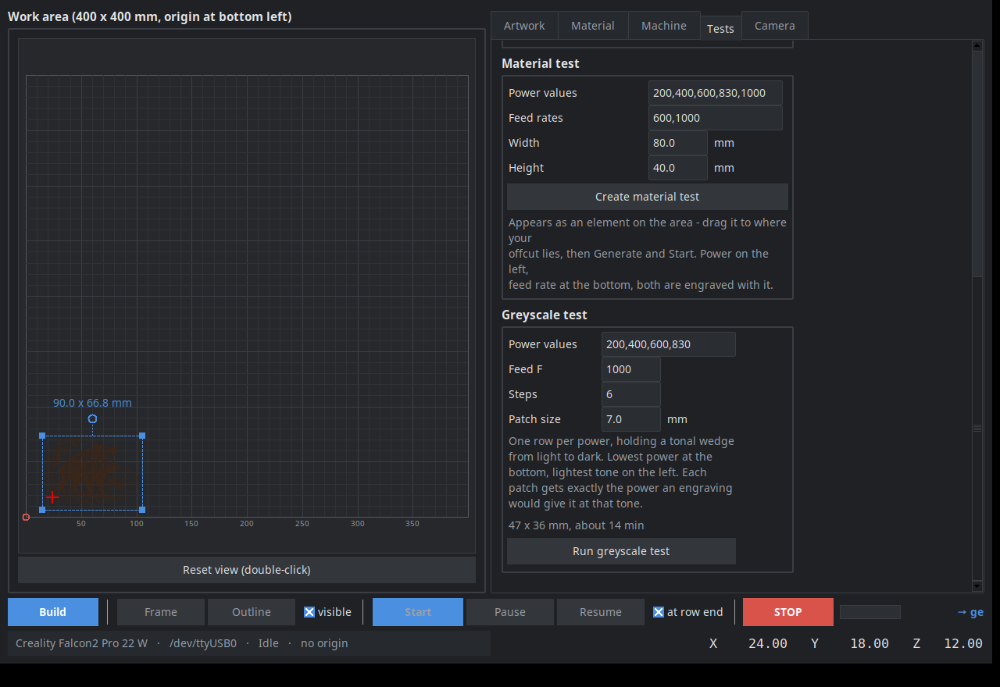

# Laserwerk

***English** · [Deutsch](README.de.md)*

Control software for diode lasers on GRBL controllers, for Linux. Drop in an
image or SVG, place it on a simulated workpiece, jog the axes, find the focus,
engrave or cut — in one window, without a subscription and without a cloud.



It exists because Linux leaves a gap: LightBurn costs money, LaserGRBL is
Windows-only, and going through an Inkscape extension plus a plain G-code
sender gets tedious as soon as you want to raster greyscales or work out
settings for a new material.

> **The interface speaks English and German** (*Machine* tab → *Language*).
> Comments and identifiers in the source are German — the project grew that
> way, and the comments carry hard-won detail that would lose its edge in
> translation. Pull requests in either language are welcome.

## What it does

- **Overscan from the machine** — in laser mode GRBL scales power with speed
  under `M4`. If the overscan is shorter than the acceleration distance, the
  start of every row burns too weakly. Laserwerk computes it from the feed
  and `$120`: at F1000 and 30 mm/s² that is 4.6 mm, not the 1.5 mm people
  usually set. That is what the field does by default — it says `0`, meaning
  "work it out". Type a number only if you want to override it.
- **Engrave** — images (PNG, JPG, WEBP, BMP) and SVG as a raster, row by row:
  black and white with a threshold, greyscale with varying power, or
  Floyd-Steinberg dithering, where every dot burns at the same power and the
  tone comes from dot density — the answer for material with a sharp
  threshold. Plus a midtone control and overscan at the row ends.
- **Energy per millimetre** — what cuts is not the power but
  `0.33 · S/F · passes` J/mm. Laserwerk prints it next to every cut. And
  since power, feed and passes belong to the element: when they are far apart
  within one job, Laserwerk asks before generating and offers to use the
  strongest for all of them. Before that, one part was cut through while the
  other four were merely scored with the engraving values — 0.27 against
  6.0 J/mm, and you only saw it on the workpiece.
- **Cut** — contours from SVG and DXF, inner before outer, several passes,
  original size 1:1 for templates straight out of CAD.
- **Both in one run** — engrave first, then cut it out, with its own power and
  feed for the cut. In that order, otherwise the part drops out before it is
  engraved.
- **Image correction** — brightness, contrast and sharpening, plus an Auto
  button that takes the black and white point from the image. Photos nearly
  always need it: a light grey background otherwise burns as a thin carpet of
  dots and eats the subject's contrast.
- **Colours as layers** — an SVG with several stroke colours can be split
  into layers on loading: red is cut, the rest engraved. Every layer keeps
  the scale and position of the whole drawing, so they stay in register.
  What gets engraved is the layer's line work, not the filled original.
- **Cut templates without their cut lines** — an SVG that carries the artwork
  as an embedded image and the cut lines as paths around it is rastered as if
  only the image were in it. Otherwise the jigsaw pattern burns straight
  across the artwork, and the template is of no use for the next run. The
  switch sits with the engraving settings and only appears when the file
  really holds both. Width and height apply to the **engraving**; the cut
  keeps its distance from it and therefore reaches beyond the artwork
  rectangle. It needs room on every side — if it ends up before the origin,
  Laserwerk says which offset will do.
- **Several elements** — artwork as a PNG, frame as an SVG, both on the same
  workpiece: each element with its own file, placement and settings, together
  in one preview, one G-code run and one project file. Everything is engraved
  first, then everything is cut — including elements that do both themselves.
  Otherwise the first part would already be loose in the board while the
  second one is still being engraved. The mode belongs to the element: change
  it and Laserwerk asks whether the others should follow — loading five cut
  files and clicking "cut" once used to engrave four of them. A newly loaded
  element lands next to the others instead of on top of them, and starts a
  new row once the old one is full. A drawing comes in at its own size — a
  cut blown up to the full travel is never what was meant.
- **Draw shapes** — a rectangle with its measurements and corner radius, or a
  frame around the selected artwork with a margin all round. No drawing
  program needed for the simple case, and the result is an ordinary element
  like any other. The project file stores the few numbers, not an image.
- **Place** — enter the length and width of your workpiece, then drag the
  artwork onto it with the mouse and resize it by its corners, snapping to
  edges, corners and centre. Turn it with the mouse by the handle above its
  top edge, about its centre and to any angle — snapping to 15° steps. The
  pointer says what a click would do: move, scale, rotate.
  The distances to all four edges sit next to it as fields — readable while
  dragging and typeable when it has to be exactly 5 mm off the right edge.
- **Trace the outline** — not just the bounding box but the real cut
  contour from SVG or DXF, at low power. For a rotated or round part the
  rectangle says little about whether it fits the board.
- **Drive the machine** — jog the axes, set the origin, set a Z reference,
  trace a frame around the artwork, show where the head stands with a short
  sight cross at low power, unlock, send single G-code commands.
- **Two machines** — anyone working on two lasers in turn picks the active
  one at the top of the Machine tab. Travel, acceleration, rapid rate,
  power, focus correction, the runtime measurements **and the presets** all
  come along: S/F is measured at one power, and the same list at 5.5 W and
  at 22 W would be a trap that springs on the first board. A new machine
  starts from the current values or from a known template, and on request
  Laserwerk converts the presets to the new power — every converted value
  is marked "UNGETESTET". If the connected machine reports a travel that
  matches a different stored machine, Laserwerk asks: swapping the cable and
  forgetting to switch is otherwise exactly the first burnt board.
- **The machine states its own numbers** — on connecting, Laserwerk reads
  `$$` and takes acceleration (`$120`/`$121`), rapid rate (`$110`/`$111`) and
  junction deviation (`$11`) into the timing model; it warns about `$30` ≠
  1000, about laser mode being off (`$32`) and about a travel that does not
  match `$130`/`$131`. Where two axes differ, the smaller value wins — that
  is the one that slows the path down. Only the optical power in watts is
  typed in: the machine does not know it, and without it the energy per
  millimetre is a number without a reference. 30 mm/s² and 3000 mm/min are
  not the same thing as 500 and 8000.
- **Find material settings** — a focus test along Z, a material test as a grid
  of power and feed values, a greyscale test with one tonal wedge per power,
  and presets holding thickness, power, feed, row pitch,
  midtones **and the cutting values** — passes, cut power and cut feed are the
  numbers that take the longest to find.
- **The focus correction belongs to the machine** — it says where the focal
  plane really sits relative to the Z reference, which depends on your lens
  and setup, not on the material. So it is kept in one place rather than in
  every preset, and it survives a restart: the focus test measured it, and
  asking you to copy it into a preset by hand is asking you to lose it. You
  see it in the log at startup, as a Z height under Material and next to the
  focus test — there also as a field you can adjust without a new test.
- **A runtime estimate that learns** — the estimate computes one
  trapezoid per path from feed rate and acceleration; the axis does not stop
  for a power change, so a finer subdivision does not slow it down either.
  Direction changes do slow it down: at every corner `$11` only lets a
  certain speed through, and a traced contour has hundreds of them. Laserwerk
  accounts for them the way Grbl's planner does — without that, a cut was
  announced almost half too short.
  After every finished job the log says what was announced and what it took,
  and from the third run on the median of those measurements corrects the
  model. Measured rather than believed — a single run changes nothing.
- **Engrave both sides** — mirror about a flip axis, with a check that the
  mirrored artwork still lands in positive coordinates.
- **Remote control via Telegram** — jog the axes and trace the sight cross from
  your phone while you stand at the workpiece, pause a running job and resume
  it, and fetch the origin back. It reports when a job finishes or hits an
  alarm. The commands sit in the Telegram menu button, and the control pad
  turns into Pause / Resume / STOP while a job runs — jogging is locked then
  anyway.
- **Pause at the row end** — a feed hold stops at once, in the middle of a
  row. The beam does go out, but the braking trace lies in the artwork, and
  on resuming the row starts from standstill. With the switch in the job bar
  the pause waits for the next row: the head comes to rest in the overscan
  beside the artwork, the laser goes out with `M5`, and "Resume" restores the
  mode the job was running in.
- **Transmission errors in the log** — at the end of the job, not only while
  it runs. If a row turns out missing in the workpiece afterwards, the error
  count is the only trace that could still explain it.
- **Dry run** — `trockenlauf.py` reads a finished G-code the way GRBL 1.1
  would and says where the head goes, where the beam burns, how long it takes
  and what would go wrong: commands GRBL skips with `error:20`, a `G1` with no
  feed ever set, a beam standing still and burning, coordinates past the
  travel, `S` above `$30`. It can draw the result as a picture, and name the
  position a given command number sits at. Nothing is sent to the machine.
- **Resume** — `fortsetzen.py` finds the exact stopping point of a stalled job
  by matching the position, then streams the rest.
- **The origin lasts the whole session** — aborting soft-resets the controller,
  which clears its G92 offset. Laserwerk carries the offset along and sets it
  again afterwards, so "move to origin" still means the workpiece and not the
  machine's own zero. That holds however the stop was triggered, from the
  button or from the phone, and however long you take to unlock afterwards.
  Should it ever go missing anyway, `/nullzurueck` puts it back. An origin
  that sits on the machine's own zero — which is what you get when you set
  it right after connecting — counts as remembered too. Only a USB
  dropout ends it: after that nobody knows where the head stands, and a
  restored offset would be worse than none.
- **One line says where you stand** — machine, port, state, origin and Z
  reference at the bottom left, the position at the bottom right; during a
  job the current row instead. The job bar is split into groups (prepare —
  aim — run — STOP), and whatever is not possible right now is greyed out
  rather than answering with a message box. At the far right, in the accent
  colour, stands the next step: "open artwork", "generate G-code", "connect
  the machine", "set the origin", "ready". The explanatory texts can be
  switched off in one go once you no longer need them.

## How it looks

Generated G-code with a runtime estimate — the artwork lies on the simulated
board like a burn mark, and the frame with its handles can be dragged and
resized with the mouse:



Material values as a preset, jogging, and the tests:

| | |
|---|---|
|  |  |



While a job runs, the status line says which row out of how many the head
is on — like a 3D printer's layer counter. For cutting it counts contours
instead of rows.

## What it needs

- Python 3.10 or newer, with tkinter (`apt install python3-tk`)
- `pip install -r requirements.txt` — pyserial, Pillow, numpy
- optionally `zenity` for native GTK dialogs; without it the Tk ones are used
- a GRBL 1.1 controller on USB, and your user in the `dialout` group

```sh
git clone https://github.com/eutervogel/laserwerk
cd laserwerk
pip install -r requirements.txt
./laserwerk.sh
```

Settings, presets and the Telegram token live in `~/.config/laserwerk/`, not in
the project folder.

## Safety

A diode laser burns material, skin and retinas, and it sets fire to chips,
paper and dust. This program takes none of that off your hands.

- **Never leave it running unattended.** An engraving takes an hour; a
  smouldering nest takes less than a minute.
- **Wear goggles matched to the wavelength**, and so should anyone watching.
  Scattered blue light from the burn spot is enough to do harm.
- **Extract the fumes or work in the open.** Wood smoke is unpleasant; some
  other materials are toxic.
- **No PVC, no imitation leather, no TPU** — they release hydrogen chloride or
  hydrogen cyanide. They eat the mechanics too.
- **Keep something to put out a fire within reach.**
- The remote control only jogs the axes and traces the sight cross. It will not
  start a job, on purpose: full power belongs where somebody is watching. Even
  jogging deserves your eyes on the machine.

## The material settings are not yours

The presets shipped here were measured on **one** machine: 450 nm, 5.5 W
optical. A different laser, lens or focus means different values. Treat them as
a starting point for your own material test, not as a recipe. Too much power at
too little feed does not mean "darker", it eventually means "on fire".

If your material has a **sharp threshold** — beech, for one, marks only above
a certain power and chars just above that — set **Power from** in the
*Material* tab to the power where it begins to mark. Tones are then spread
between that value and S instead of between 30 % and S. Without it half the
tonal range sits below the threshold and does nothing, while the other half
is uniformly black. Both values come straight off the greyscale test. 0 means
the old behaviour, 30 % of S.

That goes double for **greyscale**: there every row burns across the whole
area, and the next row meets material that is already warm. On the reference
machine S175 worked on cardboard and S130 on plywood — a sixth of what the
same wood takes as line art. The S value is the maximum, reached at pure
black; below it sits a floor at 30 %, and near-white areas stay off entirely.
If an image still fills in, the **Midtones** control helps more than less
power: it lowers the middle tones only, black stays black.

What does carry over is the **S/F ratio**: power divided by feed, that is the
energy per millimetre. On the reference machine wood works at S830/F1000 =
0.83, suede at 0.25, and the sight cross runs at 0.08. Above roughly 0.20 the
beam burns in visibly — which is why the program refuses to trace a sight cross
beyond that.

For **cutting** it is easier to work in joules per millimetre: watts divided by
feed in mm/s, times the number of passes. On the reference machine 3 mm alder
starts to separate at about 3.3 J/mm and cuts cleanly at 4.0 (5 × S725/F300 at
5.5 W). Two things follow. A cut takes **energy divided by power** — how many
passes you split it into does not change the time, only the energy required
does. And for thin material the focus belongs **on the surface**; putting it
inside the material sounds plausible but cost more here than it gained.

All power values in the interface refer to a **0…1000** scale. On connecting,
Laserwerk reads `$30` from the controller and converts when sending; if yours
says 255, S830 goes out as S212 — the same fraction. It also warns when
`$32 = 0`, meaning laser mode is off: the beam then keeps burning while the
head stands still, and every pause eats a hole.

## Tested with

GRBL 1.1f on a CH340 board, a 450 nm diode laser of 5.5 W optical power,
200 × 200 mm of travel, motorised Z axis. Run on it: plywood, slate, suede,
paper (cut). White PLA cannot be marked with a blue laser — the light is
reflected.

Machine travel is set in the *Machine* tab and can be taken from `$130`/`$131`.

## Layout

| File | Purpose |
|---|---|
| `laserwerk.py` | interface, workflow, job control |
| `lw_grbl.py` | serial link, streaming, status reports |
| `lw_job.py` | raster G-code, runtime estimate, preview images, tests |
| `lw_vector.py` | SVG and DXF readers, contours, cutting G-code |
| `lw_presets.py` | material values and settings |
| `lw_style.py` | light and dark colour schemes |
| `lw_text.py` | German and English interface texts |
| `lw_dialog.py` | native dialogs through zenity, falling back to Tk |
| `lw_telegram.py` | remote control |
| `fortsetzen.py` | resume an interrupted job at its stopping point |
| `trockenlauf.py` | work through a G-code without moving anything |
| `waechter.py` | tells you on Telegram before the rows are done |
| `bilder/mach_bilder.py` | makes the screenshots above, on a hidden display |

No third-party libraries beyond pyserial, Pillow and numpy. The SVG and DXF
readers and the Telegram client are written from scratch, so nothing has to be
installed afterwards and nothing opens dialogs behind your back.

## A watchman for long jobs

A photo engraving happily runs for ten hours. Sitting next to it, you do not
want to stare at the flickering for hours, but you do want to know when the
rows are done and the cutting starts. That is what `waechter.py` is for:

```sh
python3 waechter.py --vorlauf 10
```

It runs as **its own process beside** the interface and can be started in the
middle of a job, with no restart. It sends a Telegram message when the rows
are about `--vorlauf` minutes from done (at the latest `--rest` rows before),
when the cutting starts, when the job is over, and when it can no longer see
the interface.

How it learns the state: through `tk send` it reads the texts of the display
fields out of the running Tk interpreter — read-only, like a glance at the
screen. It writes nothing into the running program, nothing to the controller,
and it does not touch the serial port. On Telegram it only calls
`sendMessage`, never `getUpdates` — that is for the bot inside the running
interface alone, as two collectors take each other's messages away (HTTP 409).

`--lesen` looks once and sends nothing; useful to check that it has the right
window in front of it.

## A dry run before the long night

An engraving runs for twelve hours. Finding out afterwards that the head was
supposed to go to X 310, or that every row started burning before the axis was
up to speed, is an expensive way to learn it:

```sh
python3 trockenlauf.py job.nc --bild vorschau.png
```

It interprets the file the way the controller would — modal state, G90/G91,
G20/G21, M3 against M4, `S` and `F` carried forward — and prints the extent in
X and Y against your travel, the burning and non-burning path, the runtime
using the same calibrated model as the preview, the largest `S/F`, and where
the head ends up. Findings are collected rather than thrown, so one run shows
everything at once.

`--bild` draws what would end up on the board. `--bei 1864777` says which line
a given command number sits on and where the head stood — useful when a job
stalled and you want to know where. The exit status is 1 when anything was
found.

## Translations

`lw_text.py` maps each German source string to its English counterpart. A
missing entry simply falls back to German, so nothing breaks. To add a
language, copy the table and extend `SPRACHEN`.

## Tests

```sh
python3 -m unittest discover -s tests -t tests
```

441 tests on stdlib only, nothing to install. The interface tests need a
display and are skipped without one; prefix `xvfb-run -a` to run them on a
hidden screen. Details in [tests/README.md](tests/README.md).

## Licence

MIT, see [LICENSE](LICENSE). Without any warranty — in particular for whatever
your machine does with it.
