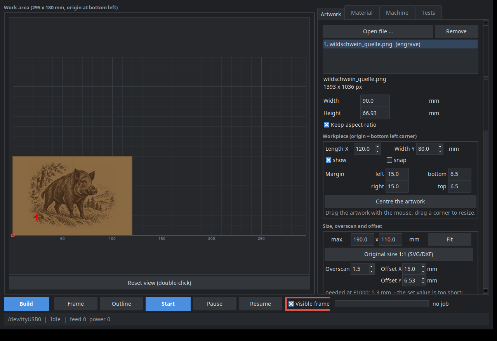
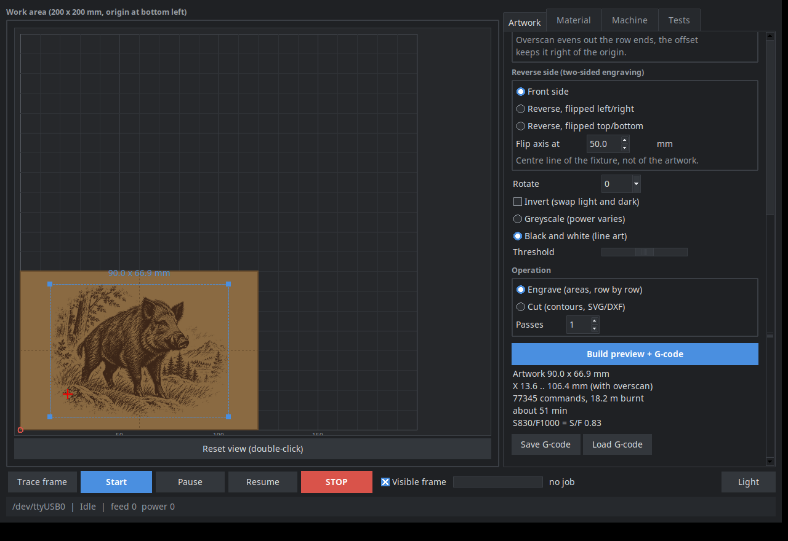
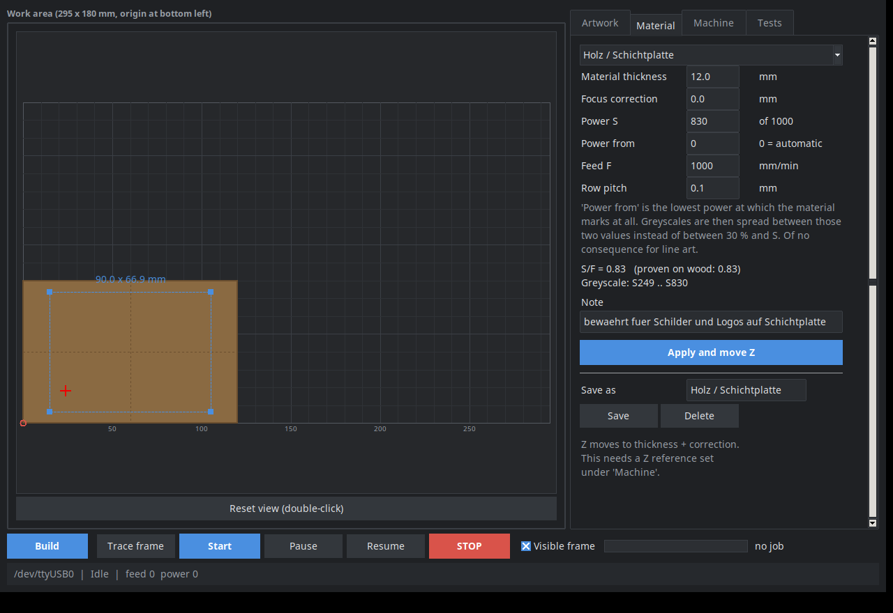
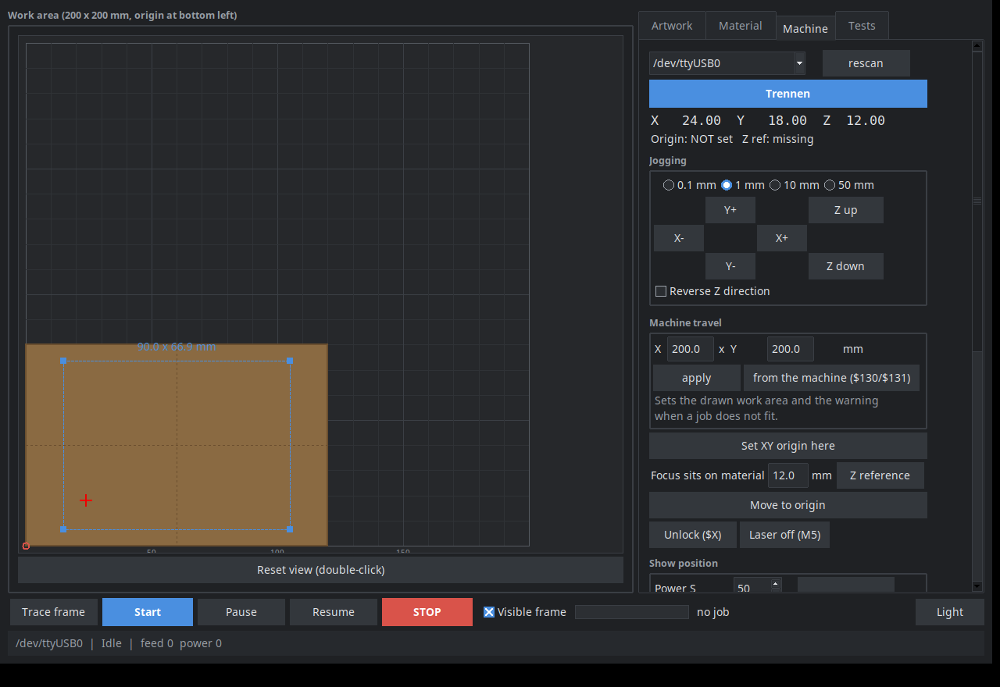
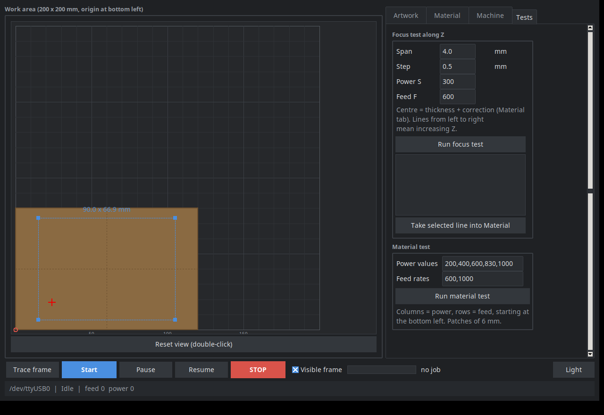

# Laserwerk

***English** · [Deutsch](README.de.md)*

Control software for diode lasers on GRBL controllers, for Linux. Drop in an
image or SVG, place it on a simulated workpiece, jog the axes, find the focus,
engrave or cut — in one window, without a subscription and without a cloud.



It exists because Linux leaves a gap: LightBurn costs money, LaserGRBL is
Windows-only, and going through an Inkscape extension plus a plain G-code
sender gets tedious as soon as you want to raster greyscales or work out
settings for a new material.

> **The interface speaks English and German** (*Machine* tab → *Language*).
> Comments and identifiers in the source are German — the project grew that
> way, and the comments carry hard-won detail that would lose its edge in
> translation. Pull requests in either language are welcome.

## What it does

- **Overscan from the machine** — in laser mode GRBL scales power with speed
  under `M4`. If the overscan is shorter than the acceleration distance, the
  start of every row burns too weakly. Laserwerk computes it from the feed
  and `$120`: at F1000 and 30 mm/s² that is 4.6 mm, not the 1.5 mm people
  usually set.
- **Engrave** — images (PNG, JPG, WEBP, BMP) and SVG as a raster, row by row:
  black and white with a threshold, greyscale with varying power, or
  Floyd-Steinberg dithering, where every dot burns at the same power and the
  tone comes from dot density — the answer for material with a sharp
  threshold. Plus a midtone control and overscan at the row ends.
- **Cut** — contours from SVG and DXF, inner before outer, several passes,
  original size 1:1 for templates straight out of CAD.
- **Image correction** — brightness, contrast and sharpening, plus an Auto
  button that takes the black and white point from the image. Photos nearly
  always need it: a light grey background otherwise burns as a thin carpet of
  dots and eats the subject's contrast.
- **Place** — enter the length and width of your workpiece, then drag the
  artwork onto it with the mouse and resize it by its corners, snapping to
  edges, corners and centre. Rotate to any angle, not just multiples of 90°.
  The distances to all four edges sit next to it as fields — readable while
  dragging and typeable when it has to be exactly 5 mm off the right edge.
- **Trace the outline** — not just the bounding box but the real cut
  contour from SVG or DXF, at low power. For a rotated or round part the
  rectangle says little about whether it fits the board.
- **Drive the machine** — jog the axes, set the origin, set a Z reference,
  trace a frame around the artwork, show where the head stands with a short
  sight cross at low power, unlock, send single G-code commands.
- **Find material settings** — a focus test along Z, a material test as a grid
  of power and feed values, a greyscale test with one tonal wedge per power,
  and presets holding thickness, focus correction, power, feed, row pitch and
  midtones.
- **Engrave both sides** — mirror about a flip axis, with a check that the
  mirrored artwork still lands in positive coordinates.
- **Remote control via Telegram** — jog the axes and trace the sight cross from
  your phone while you stand at the workpiece. It reports back when a job
  finishes or runs into an alarm.
- **Resume** — `fortsetzen.py` finds the exact stopping point of a stalled job
  by matching the position, then streams the rest.
- **The origin survives a STOP** — aborting soft-resets the controller, which
  clears its G92 offset. Laserwerk remembers it beforehand and sets it again
  afterwards, so "move to origin" still means the workpiece and not the
  machine's own zero.

## How it looks

Generated G-code with a runtime estimate — the artwork lies on the simulated
board like a burn mark, and the frame with its handles can be dragged and
resized with the mouse:



Material values as a preset, jogging, and the tests:

| | |
|---|---|
|  |  |



## What it needs

- Python 3.10 or newer, with tkinter (`apt install python3-tk`)
- `pip install -r requirements.txt` — pyserial, Pillow, numpy
- optionally `zenity` for native GTK dialogs; without it the Tk ones are used
- a GRBL 1.1 controller on USB, and your user in the `dialout` group

```sh
git clone https://github.com/eutervogel/laserwerk
cd laserwerk
pip install -r requirements.txt
./laserwerk.sh
```

Settings, presets and the Telegram token live in `~/.config/laserwerk/`, not in
the project folder.

## Safety

A diode laser burns material, skin and retinas, and it sets fire to chips,
paper and dust. This program takes none of that off your hands.

- **Never leave it running unattended.** An engraving takes an hour; a
  smouldering nest takes less than a minute.
- **Wear goggles matched to the wavelength**, and so should anyone watching.
  Scattered blue light from the burn spot is enough to do harm.
- **Extract the fumes or work in the open.** Wood smoke is unpleasant; some
  other materials are toxic.
- **No PVC, no imitation leather, no TPU** — they release hydrogen chloride or
  hydrogen cyanide. They eat the mechanics too.
- **Keep something to put out a fire within reach.**
- The remote control only jogs the axes and traces the sight cross. It will not
  start a job, on purpose: full power belongs where somebody is watching. Even
  jogging deserves your eyes on the machine.

## The material settings are not yours

The presets shipped here were measured on **one** machine: 450 nm, 5.5 W
optical. A different laser, lens or focus means different values. Treat them as
a starting point for your own material test, not as a recipe. Too much power at
too little feed does not mean "darker", it eventually means "on fire".

If your material has a **sharp threshold** — beech, for one, marks only above
a certain power and chars just above that — set **Power from** in the
*Material* tab to the power where it begins to mark. Tones are then spread
between that value and S instead of between 30 % and S. Without it half the
tonal range sits below the threshold and does nothing, while the other half
is uniformly black. Both values come straight off the greyscale test. 0 means
the old behaviour, 30 % of S.

That goes double for **greyscale**: there every row burns across the whole
area, and the next row meets material that is already warm. On the reference
machine S175 worked on cardboard and S130 on plywood — a sixth of what the
same wood takes as line art. The S value is the maximum, reached at pure
black; below it sits a floor at 30 %, and near-white areas stay off entirely.
If an image still fills in, the **Midtones** control helps more than less
power: it lowers the middle tones only, black stays black.

What does carry over is the **S/F ratio**: power divided by feed, that is the
energy per millimetre. On the reference machine wood works at S830/F1000 =
0.83, suede at 0.25, and the sight cross runs at 0.08. Above roughly 0.20 the
beam burns in visibly — which is why the program refuses to trace a sight cross
beyond that.

All power values in the interface refer to a **0…1000** scale. On connecting,
Laserwerk reads `$30` from the controller and converts when sending; if yours
says 255, S830 goes out as S212 — the same fraction. It also warns when
`$32 = 0`, meaning laser mode is off: the beam then keeps burning while the
head stands still, and every pause eats a hole.

## Tested with

GRBL 1.1f on a CH340 board, a 450 nm diode laser of 5.5 W optical power,
200 × 200 mm of travel, motorised Z axis. Run on it: plywood, slate, suede,
paper (cut). White PLA cannot be marked with a blue laser — the light is
reflected.

Machine travel is set in the *Machine* tab and can be taken from `$130`/`$131`.

## Layout

| File | Purpose |
|---|---|
| `laserwerk.py` | interface, workflow, job control |
| `lw_grbl.py` | serial link, streaming, status reports |
| `lw_job.py` | raster G-code, runtime estimate, preview images, tests |
| `lw_vector.py` | SVG and DXF readers, contours, cutting G-code |
| `lw_presets.py` | material values and settings |
| `lw_style.py` | light and dark colour schemes |
| `lw_text.py` | German and English interface texts |
| `lw_dialog.py` | native dialogs through zenity, falling back to Tk |
| `lw_telegram.py` | remote control |
| `fortsetzen.py` | resume an interrupted job at its stopping point |
| `bilder/mach_bilder.py` | makes the screenshots above, on a hidden display |

No third-party libraries beyond pyserial, Pillow and numpy. The SVG and DXF
readers and the Telegram client are written from scratch, so nothing has to be
installed afterwards and nothing opens dialogs behind your back.

## Translations

`lw_text.py` maps each German source string to its English counterpart. A
missing entry simply falls back to German, so nothing breaks. To add a
language, copy the table and extend `SPRACHEN`.

## Tests

```sh
python3 -m unittest discover -s tests -t tests
```

105 tests on stdlib only, nothing to install. The interface tests need a
display and are skipped without one; prefix `xvfb-run -a` to run them on a
hidden screen. Details in [tests/README.md](tests/README.md).

## Licence

MIT, see [LICENSE](LICENSE). Without any warranty — in particular for whatever
your machine does with it.
