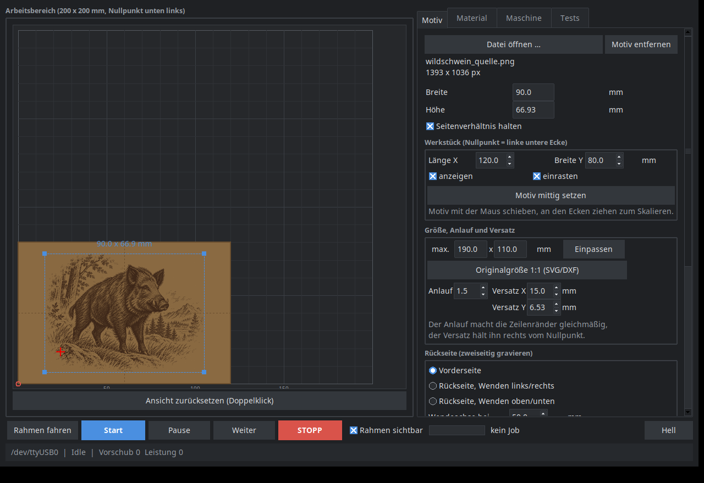
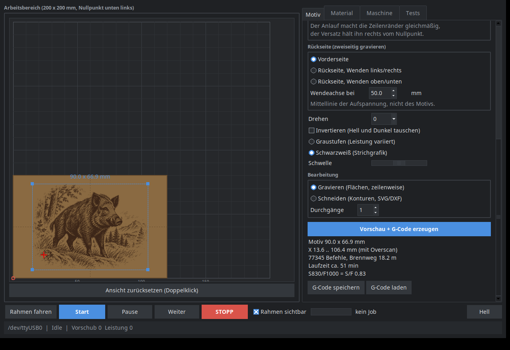
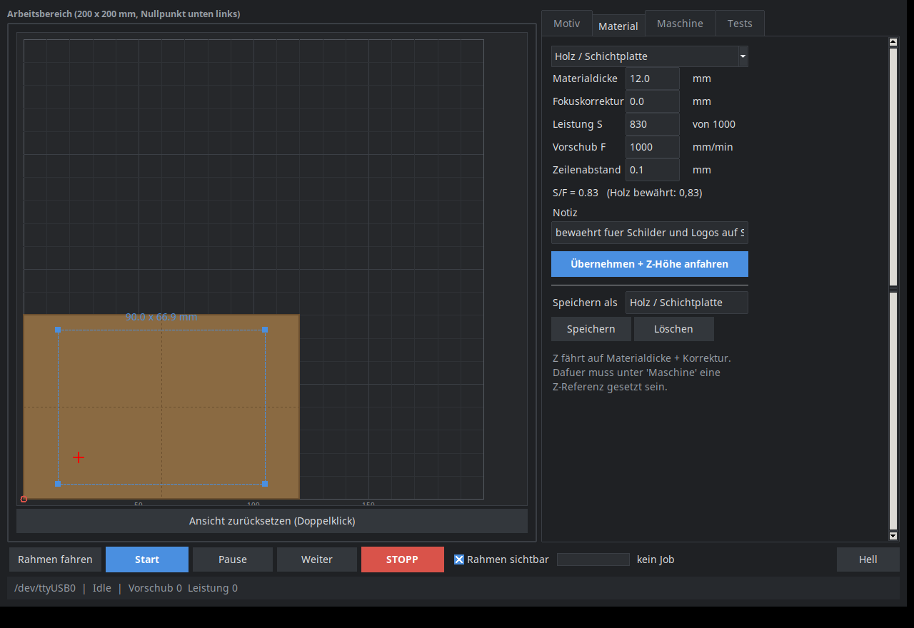
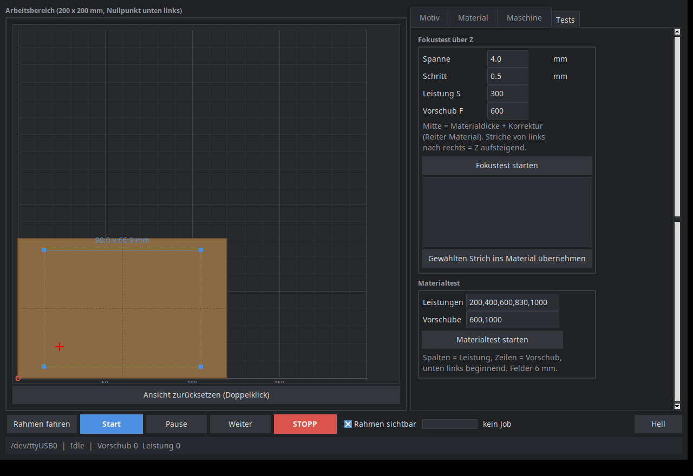

# Laserwerk

Ein Steuerprogramm für Diodenlaser an GRBL-Controllern, für Linux, auf Deutsch.
Bild oder SVG hineinwerfen, auf dem simulierten Werkstück platzieren, Achsen
fahren, Fokus suchen, gravieren oder schneiden — in einem Fenster, ohne
Abonnement und ohne Cloud.



Entstanden, weil es auf Linux wenig dazwischen gibt: LightBurn kostet Geld,
LaserGRBL läuft nur unter Windows, und der Weg über Inkscape-Erweiterungen und
einen reinen G-Code-Sender ist umständlich, sobald man Graustufen rastern oder
Material ausprobieren will.

> **Die Oberfläche und alle Kommentare im Quelltext sind deutsch.** Wer ein
> englisches Programm erwartet, ist hier falsch.

## Kann

- **Gravieren** — Bilder (PNG, JPG, WEBP, BMP) und SVG als Raster, zeilenweise,
  wahlweise schwarzweiß mit Schwelle oder Graustufen mit veränderlicher
  Leistung. Anlauf (Overscan) an den Zeilenenden für saubere Ränder.
- **Schneiden** — Konturen aus SVG und DXF, innen vor außen, mehrere Durchgänge,
  Originalgröße 1:1 für Schablonen aus dem CAD.
- **Platzieren** — Werkstück mit Länge und Breite angeben, Motiv mit der Maus
  darauf schieben und an den Ecken skalieren, mit Einrasten auf Kanten, Ecken
  und Mitte.
- **Maschine fahren** — Achsen tippen, Nullpunkt setzen, Z-Referenz,
  Rahmenfahrt um das Motiv, Sichtkreuz mit schwacher Leistung („wo steht er
  gerade?"), Entsperren, einzelne G-Code-Befehle.
- **Material finden** — Fokustest über Z, Materialtest als Feldraster aus
  Leistungen und Vorschüben, Presets mit Materialdicke, Fokuskorrektur,
  Leistung, Vorschub und Zeilenabstand.
- **Zweiseitig gravieren** — Spiegeln an einer Wendeachse, mit Prüfung, ob das
  gespiegelte Motiv noch im positiven Bereich liegt.
- **Fernsteuerung über Telegram** — Achsen und Sichtkreuz vom Handy, während man
  am Werkstück steht. Meldet sich, wenn ein Job fertig ist oder in Alarm geht.
- **Fortsetzen** — `fortsetzen.py` findet nach einem hängengebliebenen Job die
  genaue Stoppstelle über die Position und streamt den Rest.

## So sieht das aus

Erzeugter G-Code mit Laufzeitschätzung — das Motiv liegt als Brandspur auf dem
simulierten Brettchen, der Rahmen mit den Anfassern lässt sich mit der Maus
schieben und skalieren:



Materialwerte als Preset, Achsensteuerung und die Tests:

| | |
|---|---|
|  |  |



## Braucht

- Python 3.10 oder neuer, mit tkinter (`apt install python3-tk`)
- `pip install -r requirements.txt` — pyserial, Pillow, numpy
- optional `zenity` für native GTK-Dialoge; fehlt es, nimmt das Programm die
  Tk-eigenen
- einen GRBL-1.1-Controller am USB-Port, Benutzer in der Gruppe `dialout`

```sh
git clone <dieses Repository>
cd laserwerk
pip install -r requirements.txt
./laserwerk.sh
```

Einstellungen, Presets und der Telegram-Token liegen unter
`~/.config/laserwerk/`, nicht im Projektordner.

## Sicherheit

Ein Diodenlaser verbrennt Material, Haut und Netzhaut, und er entzündet Späne,
Papier und Staub. Dieses Programm nimmt einem davon nichts ab.

- **Nie unbeaufsichtigt laufen lassen.** Eine Gravur läuft eine Stunde; ein
  Glimmnest braucht keine Minute.
- **Schutzbrille für die Wellenlänge des Lasers**, auch für alle, die zusehen.
  Blaues Streulicht an der Brennstelle reicht.
- **Absaugen oder ins Freie lüften.** Holzrauch ist unangenehm, manches andere
  giftig.
- **Kein PVC, kein Kunstleder, kein TPU** — dabei entsteht Chlorwasserstoff
  beziehungsweise Blausäure. Sie fressen auch die Mechanik.
- **Löschmittel in Reichweite.**
- Die Fernsteuerung fährt nur Achsen und das Sichtkreuz. Einen Job startet sie
  mit Absicht nicht: Volle Leistung gehört dorthin, wo jemand hinsieht. Auch
  Achsen bitte nur fahren, während man die Maschine im Blick hat.

## Die Materialwerte sind nicht deine

Die mitgelieferten Presets wurden auf **einer** Maschine gemessen: 450 nm,
5,5 W optisch. Anderer Laser, andere Linse, anderer Fokus, andere Werte. Sie
sind ein Startpunkt für einen eigenen Materialtest, kein Rezept. Zu viel
Leistung bei zu wenig Vorschub heißt nicht „dunkler", sondern irgendwann
„brennt".

Was übertragbar ist, ist das **Verhältnis S/F**: Leistung geteilt durch
Vorschub, also die Energie je Millimeter. Auf der Referenzmaschine hat sich
Holz bei S830/F1000 = 0,83 bewährt, Wildleder bei 0,25, das Sichtkreuz läuft bei
0,08. Über etwa 0,20 brennt der Strahl sichtbar ein — deshalb weigert sich das
Programm, ein Sichtkreuz oberhalb davon zu fahren.

Alle Leistungen in der Oberfläche beziehen sich auf die Skala **0…1000**. Beim
Verbinden liest Laserwerk `$30` aus dem Controller und rechnet beim Senden um;
steht dort 255, wird aus S830 eben S212 — derselbe Anteil. Es warnt außerdem,
wenn `$32 = 0` ist, also der Lasermodus aus: dann brennt der Strahl auch im
Stillstand weiter, und jede Pause frisst ein Loch.

## Getestet mit

GRBL 1.1f auf einem CH340-Board, Diodenlaser mit 450 nm und 5,5 W optischer
Leistung, 200 × 200 mm Verfahrweg, Z-Achse mit Motor. Dort gelaufen:
Schichtplatte, Schiefer, Wildleder, Papier (geschnitten). Weißes PLA ist mit
einem blauen Laser nicht zu markieren — das Licht wird reflektiert.

Der Verfahrweg steht im Reiter *Maschine* und lässt sich aus `$130`/`$131`
übernehmen.

## Aufbau

| Datei | wofür |
|---|---|
| `laserwerk.py` | Oberfläche, Ablauf, Jobsteuerung |
| `lw_grbl.py` | serielle Anbindung, Streaming, Statusberichte |
| `lw_job.py` | Raster-G-Code, Laufzeitschätzung, Vorschaubilder, Tests |
| `lw_vector.py` | SVG- und DXF-Einleser, Konturen, Schnitt-G-Code |
| `lw_presets.py` | Materialwerte und Einstellungen |
| `lw_style.py` | helles und dunkles Farbschema |
| `lw_dialog.py` | native Dialoge über zenity, mit Tk als Rückfall |
| `lw_telegram.py` | Fernsteuerung |
| `fortsetzen.py` | abgebrochenen Job an der Stoppstelle fortsetzen |

Keine Fremdbibliotheken außer pyserial, Pillow und numpy. SVG, DXF und die
Telegram-Anbindung sind selbst geschrieben, damit nichts nachinstalliert werden
muss und nichts im Hintergrund Dialoge öffnet.

## Lizenz

MIT, siehe [LICENSE](LICENSE). Ohne jede Gewährleistung — besonders für das,
was deine Maschine damit anstellt.
